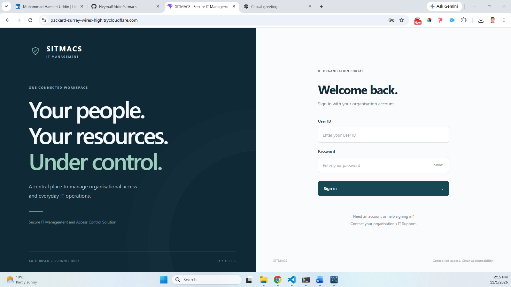
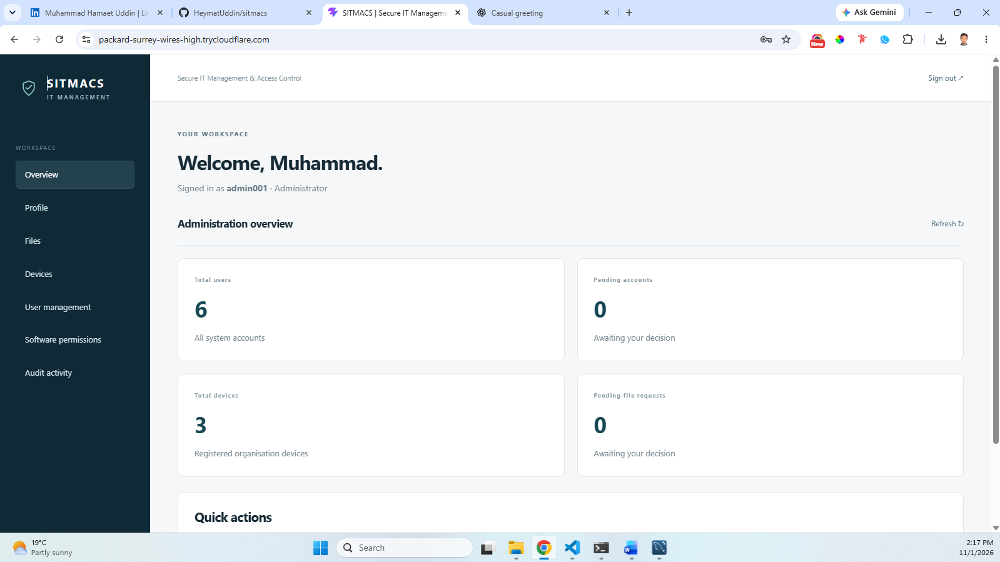
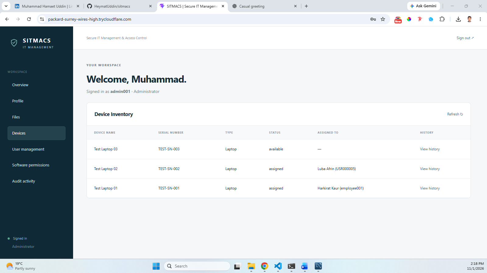

# SITMACS

Secure IT Management and Access Control Solution is an academic full-stack project for managing user access, device assignments, file requests and software requests. It demonstrates application authentication, role-based permissions and administrative workflows.

## Technology

- Frontend: React, Vite, JavaScript and CSS.
- Backend: Node.js, Express, mysql2, bcrypt, JSON Web Tokens, Multer and dotenv.
- Database: MySQL.
- Testing: Node.js test runner, with database doubles in HTTP authentication tests.
- Optional external service: VirusTotal file analysis API.

## Features

- Administrator, Employee, IT Support and IT Security Officer roles.
- Account approvals and pending, active, locked, suspended and disabled states.
- Password hashing, first-login password changes and employee profile completion checks.
- Login lockout, request rate limiting, expiring JWTs and database-backed session revocation.
- Device inventory, assignment and return records.
- File upload, access requests, approvals and controlled downloads.
- Optional VirusTotal submission and analysis status checks.
- Software request review workflows and category-filtered audit logs.
- Administrator summary endpoint for selected record counts.

The backend implementation was inspected for this documentation. The frontend source was not supplied for review; its commands and stack are based on the supplied package.json. This is a local academic application, not a production security certification.

## Local requirements

Use Node.js and npm versions compatible with the locked dependencies in both packages. Vite 8 has its own Node.js requirements; if installation reports an unsupported engine, use a compatible supported Node.js release. Use MySQL 8 or a compatible newer release supporting utf8mb4_0900_ai_ci, JSON and generated stored columns. MySQL Workbench is convenient for importing the schema.

## Installation

```powershell
git clone https://github.com/HeymatUddin/sitmacs.git
cd sitmacs
cd backend
npm ci
cd ..\frontend
npm ci
cd ..
```

## Fresh database setup

Use a NEW, EMPTY local database. This schema is a fresh-install snapshot, not an upgrade script for an existing database. It intentionally has no DROP TABLE commands; importing into an existing schema will fail on existing table names.

In MySQL Workbench run:

```sql
CREATE DATABASE sitmacs_db CHARACTER SET utf8mb4 COLLATE utf8mb4_0900_ai_ci;
USE sitmacs_db;
```

Open database/schema.sql in Workbench, select sitmacs_db as the default schema, and execute the complete file. It creates 12 tables, the four application roles and the user-ID sequence. It contains no user accounts or private records.

The schema snapshot already contains the security, profile and sequence tables. Do not reapply migrations as an extra fresh-install step. Existing installations should preserve their database and apply only the migrations they need after reviewing their current structure.

## Backend environment

From the repository root:

```powershell
Copy-Item backend/.env.example backend/.env
node -e "console.log(require('crypto').randomBytes(48).toString('hex'))"
```

Copy the generated random value into JWT_SECRET in backend/.env. Configure your local DB_USER and DB_PASSWORD. Never commit this file. The application rejects a JWT_SECRET shorter than 32 bytes or beginning with replace_.

| Variable | Purpose |
|---|---|
| DB_HOST | MySQL host, default localhost |
| DB_PORT | MySQL port, default 3306 |
| DB_USER | Local MySQL account |
| DB_PASSWORD | Local MySQL password |
| DB_NAME | Database name, default sitmacs_db |
| PORT | Backend port, default 5000 |
| FRONTEND_ORIGIN | Comma-separated allowed frontend origins, default http://localhost:5173 |
| JWT_SECRET | Private random signing secret |
| VIRUSTOTAL_API_KEY | Optional external file scanning API key |

## Create the first administrator

After importing the schema and setting the database environment:

```powershell
cd backend
node scripts/bootstrap-admin.js
```

Enter an Administrator User ID, full name and email. The script hashes a generated temporary password and prints it once. Keep it private and change it on first login. Setup stops if any users already exist, or if the Administrator role is missing. There is no shared default password. Do not run seed-initial-users.js before this step.

## Start the application

Terminal 1, from the backend directory:

```powershell
npm run dev
```

Backend: http://127.0.0.1:5000. Check http://127.0.0.1:5000/api/health. The server binds to 127.0.0.1 and is not exposed to the network by default.

Terminal 2, from the repository root:

```powershell
cd frontend
npm run dev
```

Open the URL printed by Vite. If it differs from http://localhost:5173, update FRONTEND_ORIGIN and restart the backend. Verify the frontend's API URL or proxy points to the local backend; frontend configuration was not inspected in this review.

## Checks

```powershell
# From backend
npm test

# From frontend
npm run lint
npm run build
```

The HTTP authentication tests use database doubles: passing them does not verify a real MySQL installation, all device/file/software workflows, or the external scanning service. Validate those flows separately against a disposable local database.

Suggested manual checks: bootstrap and first login, password change, member account approval, role-denied access, device assignment/return, file request review, software request review, and audit log visibility.

## API groups

| Base path | Area |
|---|---|
| /api/auth | Authentication and password changes |
| /api/users | Account management |
| /api/profile | Profile completion |
| /api/devices | Devices and assignments |
| /api/files | Uploads, requests, review, scanning and downloads |
| /api/software | Software requests |
| /api/audit-logs | Authorised audit log queries |
| /api/dashboard/admin-summary | Administrator summary counts |
| /api/health | Health response |

## File scanning and limitations

VirusTotal scanning sends the selected file to an external service and requires an API key, network access and available quota. Use harmless sample files for demonstrations, not confidential documents. A clean scan result is not proof that a file is safe. Uploads are limited to 5 MB by the current backend. Local storage is created automatically and should remain excluded from Git.

This project does not implement Microsoft Entra ID or Azure integration. Keycloak is not part of this application. Deployment with HTTPS, hosting configuration and operational hardening are separate work. Audit logs have no application edit/delete API, but a database administrator can alter them; they are not tamper-proof storage.

## Troubleshooting

- Unknown database or missing tables: check DB_NAME and import the fresh schema into an empty database.
- Administrator role missing: confirm the role INSERT statements at the end of schema.sql ran.
- Invalid signing-secret configuration: generate a private random JWT_SECRET as described above.
- Access denied for MySQL user: check credentials and database grants locally.
- Requests blocked by the browser: match the actual frontend origin and verify frontend API configuration.
- Scan unavailable: check external service configuration and quota; ordinary local login does not require the scan key.
- Existing database: do not import the fresh schema over it. Preserve it and review migrations separately.

## Project status

Developed as an academic project by Muhammad Hamaet Uddin. This README documents the supplied backend and database structure; fresh MySQL import and full frontend operation have not been executed in this documentation environment. Add screenshots using sample accounts and a short demo after verifying the local setup.


## Screenshots

### Login


### Administrator Dashboard


### Device Management

